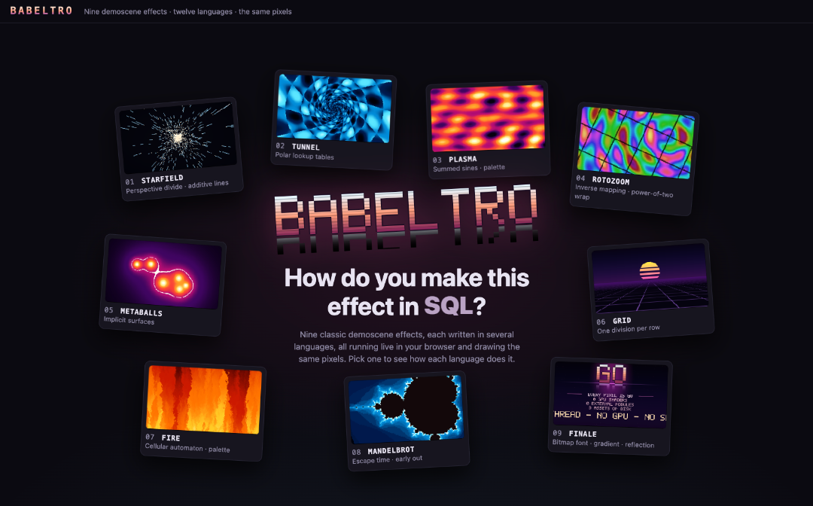
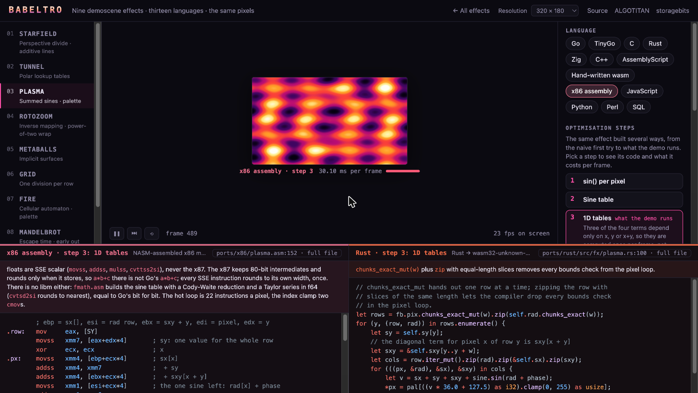

# babeltro

**How do you make a plasma in Perl? A tunnel in SQL? A fire in hand-written
WebAssembly?**

Nine classic demoscene effects — starfield, tunnel, plasma, rotozoom,
metaballs, synthwave grid, fire, Mandelbrot, a logo card — written in thirteen
languages and run live, side by side, in your browser. Every pixel is
computed on the CPU, and every port draws **the same pixels** as the C
reference, bit for bit. Babel for the languages, "-tro" for the intro.

**Live: <https://babeltro.storagebits.workers.dev>**



The point is not which language wins. It is what each one makes you write
to produce the same image: float widths, fused multiply-adds, float-to-int
conversion, bounds checks, evaluation order, the maths library — and, for
some, the absence of a maths library.

## What is in the lab

- **Each language's hot loop** under the canvas, next to a second language
  of your choice, with a one-line note on what each does differently.
- **Optimisation ladders** for the plasma, the tunnel and the Mandelbrot:
  the naive version first, then one trick at a time; any rung can run next
  to the last one, with a pixel diff: grey where they match, magenta where
  they do not.
- **A race**: every language on the current effect, timed, checked against
  the reference.

## The languages

| Language | Directory | How it gets into the browser | Effects |
| --- | --- | --- | --- |
| Go | `go/` | wasm, Go's own backend | 9 |
| TinyGo | `ports/tinygo/` | the same Go files, compiled through LLVM | 9 |
| C | `ports/c/` | clang + wasi-libc — **the reference** | 9 |
| C++ | `ports/cpp/` | clang + libc++, C++23 | 9 |
| Rust | `ports/rust/` | wasm32-unknown-unknown, no dependencies | 9 |
| Zig | `ports/zig/` | wasm32-freestanding, comptime tables | 9 |
| AssemblyScript | `ports/assemblyscript/` | asc, no imports | 9 |
| WebAssembly, by hand | `ports/wat/` | hand-written WAT, its own sin/atan2/exp, 14.5 KB | 9 |
| x86 assembly | `ports/x86/` | NASM machine code on a tiny 386+SSE emulator in wasm | 9 |
| JavaScript | `ports/js/` | plain ES modules, `Math.fround` everywhere | 9 |
| Python | `ports/python/` | CPython + NumPy in wasm (Pyodide) | 9 |
| Perl | `ports/perl/` | Perl 5.42 in wasm (zeroperl) | 9 |
| SQL | `ports/sql/` | SQLite in wasm (sql.js), one query per frame | 9 |

Every effect a port implements is byte-identical to the reference at every size and
rung tested. The one exception is by design: the finale spells the
language's name, and its layout follows the name's width.

A few things the ports found:

- **The timings measure compilers as much as languages.** The same Go code
  is 1.5–3× faster built by TinyGo than by Go's own wasm backend, which keeps
  every function resumable for goroutines. Native Go is faster still.
- **SQLite has no float32**, so the SQL port emulates Go's float32 rounding
  in pure SQL with Veltkamp's split. Without it, a few hundred pixels a
  minute drift.
- **x86 assembly runs on an emulator** written for the occasion: 22
  emulated instructions per plasma pixel, SSE only, because x87's 80-bit
  intermediates would break pixel identity.
- **WebAssembly has no `sin`.** The hand-written port computes its sine table
  with a Cody-Waite reduction and a Taylor series: all 8193 entries match
  Go's bit for bit.
- **Perl matches too**, at a price: `unpack 'f', pack 'f'` after every
  float32 operation, a third of its frame time.
- **The Pythonic plasma is not a loop**: the NumPy version is 100–250× faster
  than the plain-Python rungs.



Each port's `NOTES.md` says what it does differently, effect by effect.

## Running it

```sh
cd web
npm install
../scripts/build-all.sh   # builds every wasm port into web/public/wasm
npm run dev
```

The ports need their toolchains (LLVM with wasi-libc, Rust, Zig, TinyGo,
AssemblyScript, wabt); the Perl port fetches its interpreter with
`ports/perl/fetch.sh`. Python, Perl and SQL bring their interpreters as
wasm and need nothing to build.

Keys: `Space` pause, `←`/`→` effect, `.` one frame, `R` restart, `D`
differences (ladders), `Esc` home.

## Checking a port

```sh
node tools/check.mjs go rust js                   # every effect against C
node tools/check.mjs --scene 2 --step 1 python    # one rung of a ladder
node tools/check.mjs --png /tmp/diff --size 160x90 perl
```

The contract every port follows, and how to add a language, is
[`spec/ABI.md`](spec/ABI.md). What could come next is in
[`docs/ROADMAP.md`](docs/ROADMAP.md). `go/` also still builds the original
native demo (a window, a HUD, a worker pool): see `go/README.md`.

## Licence

MIT — see [`LICENSE`](LICENSE).
